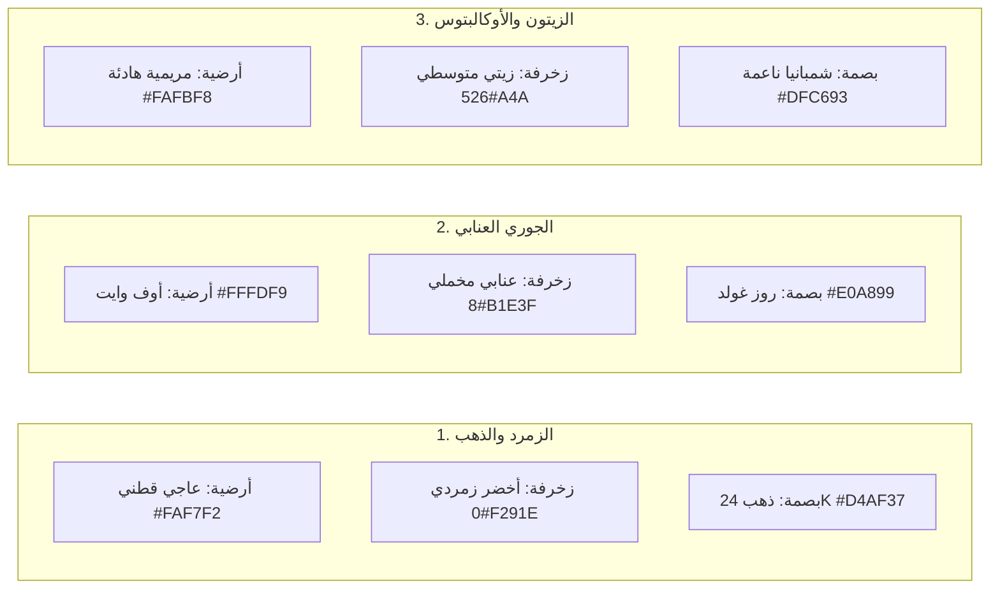

# 👑 دليل هندسة وتصميم دعوات الأعراس الملكية العربية (Arabic Wedding Stationery)

هذا الدليل يمثل المرجع المعماري والفني الكامل لتصميم وتطوير واجهات وبطاقات دعوات الأعراس الفاخرة باللغة العربية، بنظام القطع المتعددة والثيمات المتناسقة ومحاكاة الطباعة الواقعية.

---

## 🏛️ 1. هندسة الدعوات المركبة (Multi-Piece Suite Architecture)

تنقسم دعوات الأعراس العالمية إلى 3 فئات هيكلية بحسب عدد القطع والتجميع:

### أ) الدعوات أحادية القطعة (Single-Piece Flat Suites)
- **الهدف**: دعوة مستقلة رشيقة، تطبع بوجهين متطابقين 1:1 مليمتر، وتعتمد على جمال مسار القص الخارجي (Die-Cut Silhouette).
- **أشهر القوالب**:
  1. **القوس الملكي الكلاسيكي (Royal Arch)**: نصف دائرة علوية بقطر 600px مستقيمة الجانبين.
  2. **الكبسولة الطولية المودرن (Vertical Capsule / Pill)**: نصفا دائرة متناظران بالأعلى والأسفل بانسيابية 100%.
  3. **اللوحة مشطوفة الزوايا (Chamfered Luxury Plaque)**: شطفات هندسية 45 درجة متناظرة مع إطار حفر مذهب.
  4. **مروحة البتلات الفرنسية (French Scallop Badge)**: تموجات مروحية مقوسة رومانسية.

### ب) الدعوات ثنائية القطع (2-Piece Interactive Suites)
- **الهدف**: دعوة تفاعلية تتكون من غلاف/جيب خارجي وبطاقة دعوة داخلية تنزلق أو تفتح بحركة ميكانيكية.
- **أشهر القوالب**:
  1. **طقم جيب السحب بأخدود الإبهام (Thumb-Notch Sleeve + Oval Card)**:
     - **القطعة 1**: غلاف جيب خارجي بأخدود نصف دائري علوي (قطر 80px) لسحب الكرت بسلاسة.
     - **القطعة 2**: كرت بيضاوي مقوس ينزلق داخل الجيب ويحمل تفاصيل الحفل.
  2. **بوابة الليلي ذات القفل الأفقي (Arch Gatefold + Lily Stem Clasp)**:
     - **القطعة 1**: درفتا بوابة متماثلتان تنغلقان بشق أفقي.
     - **القطعة 2**: زهرة زنبق الليلي تنزلق في الشق لقفل البوابة وتفكيكها عند الفتح.
  3. **مروحة الورد وحلقة التاريخ المنفصلة (Floral Fan + Detached Donut Ring)**:
     - **القطعة 1**: كرت مروحة ورقية علوي.
     - **القطعة 2**: حلقة دونات دائرية مفرغة مطبوعة بنص دائري `textPath` لتوثيق تاريخ الزفاف.

### ج) الدعوات ثلاثية القطع المركبة (3-Piece Full Luxury Packaging Suites)
- **الهدف**: بكج المناسبة الكامل الذي يضاهي أفخم متاجر الهدايا وقصور الأعراس.
- **أشهر القوالب**:
  1. **طقم المظروف المعماري والبطانة الموردة (Lined Envelope + Polaroid Card + Euro-Flap Liner)**:
     - **القطعة 1**: كرت البولارويد والأسماء مع ختم شمعي علوي وإطار صورة العروسين.
     - **القطعة 2**: مظروف يورو-فلاب هندسي مدبب (Euro-Flap) مع خطوط ريجة للطي.
     - **القطعة 3**: بطانة داخلية موردة (Envelope Liner) مرسومة بالألوان المائية تُثبت تحت الغطاء.
  2. **مطوية الغابة غير المتماثلة وشريطة الستان (Asymmetric Gatefold + Inner Card + Ribbon Bow)**:
     - **القطعة 1**: غلاف غير متماثل يكشف حافة الكرت الداخلي بنسبة 30%.
     - **القطعة 2**: الكرت الداخلي النقي المطبوع بذهب 24K.
     - **القطعة 3**: شريطة ستان حريرية تلف خصر الدعوة وتغلق بفيونكة ملكية.

---

## 🖋️ 2. هرمية الخطوط والمخطوطات العربية (Arabic Wedding Typography Hierarchy)

توزيع النصوص العربية على الكرت يجب أن يتبع **النسبة الذهبية (Golden Ratio)** والتراتبية التالية من الأعلى إلى الأسفل:

| الترتيب | العنصر | نوع الخط الموصى به | الحجم (pt) | اللمسة الموصى بها |
| :--- | :--- | :--- | :--- | :--- |
| **1** | **ترويسة الدعوة / الختم** | ثلث جلي أو ديواني (`Aref Ruqaa` / `Amiri`) | 28 - 34 pt | ختم مذهب دائري أو إكليل غار |
| **2** | **عبارة الترحيب** | أميري أو رقعة مشكولة | 15 - 18 pt | لون متناسق مع الزخرفة |
| **3** | **الآية الكريمة** | خط مصحفي نسخ كلاسيكي | 12 - 14 pt | فحم داكن أو ذهب مطفي |
| **4** | **أسماء العروسين** | خط رقعة عريض أو نستعليق متداخل | 36 - 48 pt | بصمة ذهب حار 24K مع حفر غائر |
| **5** | **نص الدعوة السردي** | خط كلاسيكي مبسط (Cairo / Tajawal) | 12 - 13 pt | رمادي دافئ مريح للقراءة |
| **6** | **شريط التفاصيل الثلاثي** | كروت مصغرة (📅 التاريخ \| 📍 القاعة \| 🕗 الوقت) | 11 - 12 pt | حاويات ذات زوايا مستديرة وأيقونات واضحة |
| **7** | **الختام واسم الداعي** | ديواني أو رقعة رشيقة | 13 - 15 pt | بصمة مذهبة في قاعدة الكرت |

---

## 🎨 3. هندسة الثيمات ولوحات الألوان الفاخرة (Design Themes & Shaders)

تعتمد الدعوات الفخمة على التباين المدروس بين لون أرضية الكرت ولون الزخارف والمعدن:

### مرشحات الإظهار الواقعي (SVG Realistic Shaders):
- **بصمة الذهب الحار (7-Stop Hot Foil Stamping)**:
  `linearGradient` من 7 محطات تتراوح بين الذهب الداكن `#8C5A14` واللمعان البراق `#FCF6BA`.
- **الورق القطني البارز (Cotton Rag 350 GSM)**:
  مرشح `feTurbulence` بتردد 0.05 مع إضاءة منتشرة `feDiffuseLighting` لمحاكاة ألياف الورق الطبيعية.
- **ظلال الاستوديو الفوتوغرافية (Ambient Occlusion)**:
  ثلاث طبقات متدرجة من الظلال: ظل التلامس الحاد، ظل الارتفاع الناعم، وانعكاس لون الكرت على الأرضية.

---

## 📐 4. معايير القص والطباعة المزدوجة (Die-Cut & Imposition Standards)

1. **هامش الأمان والميازيب (Bleed Margin)**:
   - إضافة 3 مم (3mm Bleed) خارج مسار القص النهائي لمنع أي حواف بيضاء غير مقصودة.
2. **مطابقة الوجه والقفا (1:1 Duplex Parity)**:
   - يجب أن يشترك الوجه والقفا في نفس مسار القص تماماً، مع عكس محاذاة القفا أفقياً (Mirroring) فقط في القوالب غير المتناظرة.
3. **توزيع الملازم المزدوجة (Duplex Imposition Engine)**:
   - **ورق A4 (210×297 مم)**: رص من 4 إلى 8 كروت مع علامات القص وتطابق ظهري دقيق.
   - **ورق A3 (297×420 مم)**: رص من 8 إلى 16 كرت لاستغلال 90% من مساحة الورقة.
4. **مواصفات القص الآلي (Cameo / Skycut / Cricut)**:
   - خط القص الأحمر المتصل: شفرة عمق 3 - 3.5، قوة ضغط 27 - 30.
   - خط الريجة الأزرق المنقط: عجلة تجعيد (Scoring Wheel) لقفل وثني المطويات بدون تشقق الورق.
