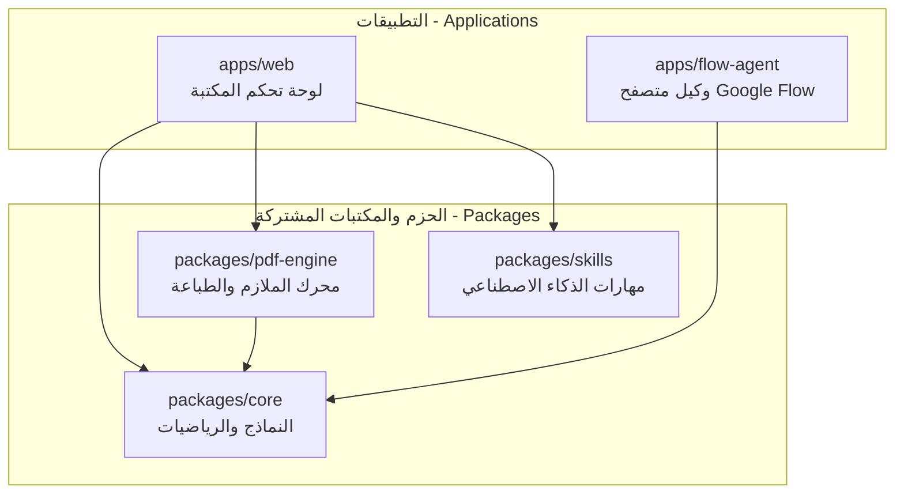

# 🏛️ وثيقة المعمارية والبنية التحتية (ARCHITECTURE.md)
## هيكلية المستودع الموحد (Monorepo Architecture) - مكتبة الشعلة
### Personalized Children's Educational Magazine & Booklet Platform

---

## 1. نظرة عامة على الـ Monorepo (Monorepo Overview)

تم تنظيم المشروع بنظام **المستودع الموحد (Monorepo)** باستخدام مساحات العمل (`pnpm-workspace.yaml`) وأداة التسريع (`turbo.json`). يتيح هذا التصميم مشاركة الأكواد والنماذج الرياضية بين التطبيقات والمكتبات بسلاسة وأمان.



---

## 2. تفصيل الحزم ومسؤولياتها (Packages & Boundaries)

| الحزمة / التطبيق | المسار | نوع الحزمة | المسؤولية الرئيسية |
| :--- | :--- | :--- | :--- |
| **`@maktaba/core`** | `packages/core` | حزمة مشتركة | تعريف نماذج البيانات (`ChildProfile`, `StoryPage`) وخوارزمية الملازم (`calculateSaddleStitchImposition`) |
| **`@maktaba/pdf-engine`** | `packages/pdf-engine` | حزمة مشتركة | قوالب الـ HTML عالية الدقة (300 DPI) لنسخة القراءة ونسخة ملازم الطباعة المزدوجة |
| **`@maktaba/skills`** | `packages/skills` | موجهات ومهارات | مهارات الكاتب التربوي، مخرج المشاهد لـ Google Flow، صانع رسومات التلوين، ومصمم المجلات |
| **`@maktaba/web`** | `apps/web` | تطبيق ويب | واجهة المستخدم العربية لموظف المكتبة وخادم التشغيل السريع |
| **`@maktaba/flow-agent`** | `apps/flow-agent` | خدمة أتمتة | روبوت المتصفح للتعامل مع Google Flow ومساعد النسخ الفوري للأوامر |

---

## 3. مسار التوسع المستقبلي (Scalability Roadmap)

```text
[المرحلة 1: الحالية] ──> تشغيل محلي بالكامل في المكتبة (Local In-Store Operator Dashboard)
[المرحلة 2: القادمة] ──> بوابة إلكترونية للأهالي (Customer Self-Service Portal) لرفع الطلبات أونلاين
[المرحلة 3: المستقبلية] ─> شبكة مكتبات متعددة الفروع (Multi-Branch Franchise Cloud Platform)
```
