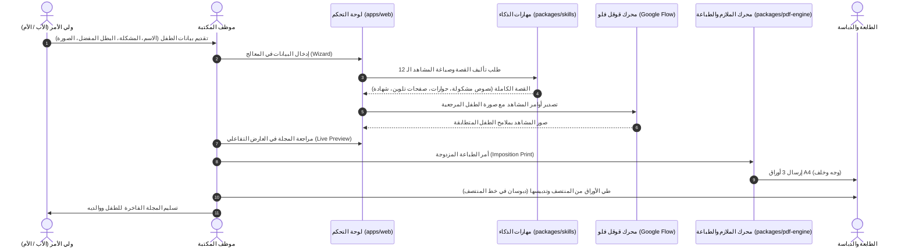

# 📐 وثيقة التصميم المعماري والهندسي (DESIGN.md)
## منصة مجلات وقصص الأطفال التربوية المخصصة - مكتبة الشعلة
### Personalized Children's Educational Magazine & Booklet Platform

---

## 1. فلسفة النظام وأهدافه المعمارية (System Philosophy & Core Objectives)

يهدف النظام إلى حل إشكالية موسمية العمل في المكتبات الجامعية من خلال تحويل مشاكل الأطفال السلوكية إلى **مجلات مطبوعة وقصص تربوية مصورة مخصصة**، يظهر فيها الطفل كبطل بجانب شخصيته الكرتونية أو بطله الخارق المفضل بملامح وجه مطابقة بنسبة 100%، مع تضمين صفحات تلوين تفاعلية وشهادة تكريم رسمية، جاهزة للطباعة والتدبيس المباشر في المكتبة.

### الركائز الأساسية للتصميم:
1. **سهولة الاستخدام لموظف المكتبة (Operator-Centric UI)**: واجهة عربية تفاعلية لا تتطلب أي خبرة برمجية.
2. **الذكاء المعتمد على المهارات (Skills-First AI Architecture)**: توجيه النماذج المجانية والمفتوحة (Gemini Flash, Nemotron Ultra, إلخ) عبر موجهات تخصصية فائقة الدقة لضمان حبكة تربوية ممتازة دون الحاجة لاشتراكات مدفوعة.
3. **التكامل الهجين مع Google Flow (Hybrid Flow Integration)**: إتاحة الأتمتة المباشرة إلى جانب مسار نسخ الأوامر اليدوي بضغطة زر واحدة.
4. **محرك الملازم والتدبيس النصفي (Saddle-Stitch Imposition Engine)**: الحساب التلقائي لترتيب الصفحات على وجهي الورقة للطباعة المزدوجة المباشرة.

---

## 2. مخطط تدفق البيانات ودورة حياة الطلب (Data Flow & Order Lifecycle)



---

## 3. خوارزمية ورياضيات ملازم التدبيس النصفي (Saddle-Stitch Imposition Mathematics)

عند طباعة مجلة مكونة من $N$ صفحة (حيث $N$ مضاعف للرقم 4، وفي هذا النظام $N = 12$) ليتم طيها وتدبيسها من المنتصف ككتيب (Booklet)، لا يمكن طباعة الصفحات بترتيب متتالٍ، بل يجب فرز صفحتين على كل وجه من الورقة.

### المعادلات الرياضية لحساب رقم الصفحة لكل ورقة $i$ (حيث $1 \le i \le \frac{N}{4}$):

1. **الوجه الأمامي للورقة (Front Side)**:
   $$\text{Left Page} = N - 2(i - 1)$$
   $$\text{Right Page} = 2(i - 1) + 1$$

2. **الوجه الخلفي للورقة (Back Side)**:
   $$\text{Left Page} = 2(i - 1) + 2$$
   $$\text{Right Page} = N - 2(i - 1) - 1$$

### جدول توزيع ملازم المجلة الـ 12 صفحة (3 أوراق A4):

| رقم الورقة ($i$) | الوجه (Side) | الصفحة اليسرى | خط المنتصف والطي | الصفحة اليمنى | الوصف والمحتوى |
| :---: | :---: | :---: | :---: | :---: | :--- |
| **ورقة 1** | **أمامي (Front)** | **صفحة 12** | $\longleftarrow \text{Fold \& Staple} \longrightarrow$ | **صفحة 1** | الغلاف الخلفي (الشهادة) بجانب الغلاف الرئيسي |
| **ورقة 1** | **خلفي (Back)** | **صفحة 2** | $\longleftarrow \text{Fold \& Staple} \longrightarrow$ | **صفحة 11** | إهداء الوالدين بجانب صفحة التلوين 3 |
| **ورقة 2** | **أمامي (Front)** | **صفحة 10** | $\longleftarrow \text{Fold \& Staple} \longrightarrow$ | **صفحة 3** | صفحة التلوين 2 بجانب مشهد القصة 1 |
| **ورقة 2** | **خلفي (Back)** | **صفحة 4** | $\longleftarrow \text{Fold \& Staple} \longrightarrow$ | **صفحة 9** | مشهد القصة 2 بجانب صفحة التلوين 1 |
| **ورقة 3** | **أمامي (Front)** | **صفحة 8** | $\longleftarrow \text{Fold \& Staple} \longrightarrow$ | **صفحة 5** | مشهد القصة 6 بجانب مشهد القصة 3 |
| **ورقة 3** | **خلفي (Back)** | **صفحة 6** | $\longleftarrow \text{Fold \& Staple} \longrightarrow$ | **صفحة 7** | مشهد القصة 4 بجانب مشهد القصة 5 (قلب المجلة) |

---

## 4. المعايير الطباعية والهندسية (Print Standards & Layout Specs)

- **مقاس الصفحة المفردة (Single Page)**: $148 \text{ mm} \times 210 \text{ mm}$ (A5 Portrait).
- **مقاس المفرش الورقي (Spread Sheet)**: $297 \text{ mm} \times 210 \text{ mm}$ (A4 Landscape).
- **هامش الأمان المركزي (Central Gutter)**: $12 \text{ mm}$ لضمان عدم تأثر النصوص بثنية الطي والدبابيس.
- **الهوامش الخارجية (Outer Margins)**: $8 \text{ mm}$.
- **الدقة الطباعية (Resolution)**: $300 \text{ DPI}$.
- **الخطوط العربية المستخدمة**:
  - `Cairo` للعناوين وأسماء الأطفال والترويسات.
  - `Amiri` للنصوص السردية وحوارات الأبطال ورسالة الأهل.

---

## 5. هيكلية المجلدات والحزم (Directory & Package Structure)

```text
├── apps/
│   ├── web/                     # لوحة التحكم وخادم الطباعة
│   │   ├── public/index.html    # واجهة المستخدم RTL
│   │   └── server.js            # خادم Node.js السريع
│   └── flow-agent/              # أتمتة ومساعد Google Flow
│       └── src/copilot.ts       # محول أوامر Google Flow
│
├── packages/
│   ├── core/                    # النماذج المشتركة والرياضيات
│   ├── pdf-engine/              # محرك الـ PDF وقوالب الطباعة
│   └── skills/                  # مهارات الذكاء الاصطناعي الأربع
│
├── DESIGN.md                    # وثيقة التصميم المعماري (هذا الملف)
├── AGENTS.md                    # وثيقة الوكلاء والمهارات
├── GEMINI.md                    # موجهات الذكاء الاصطناعي
├── ARCHITECTURE.md              # مخطط البنية التحتية
└── README.md                    # دليل البدء السريع
```
